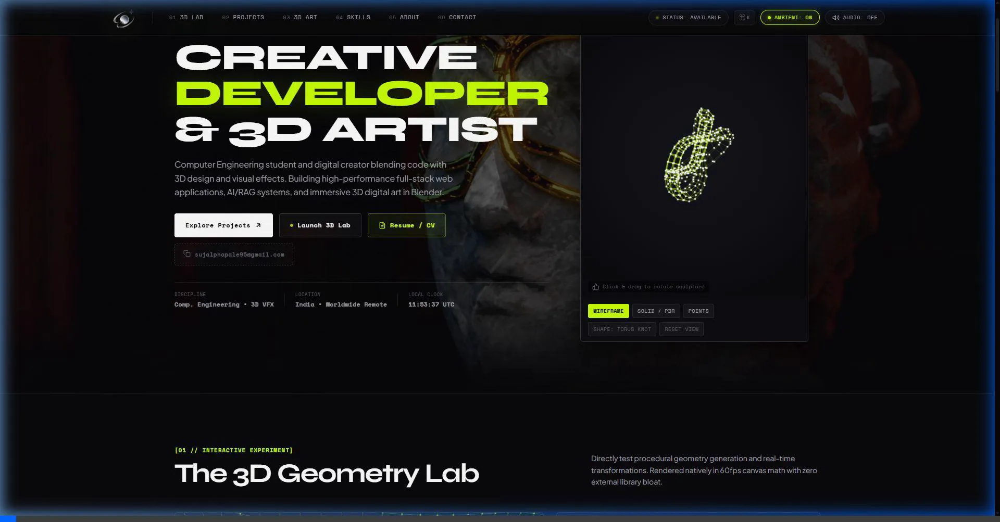

# Sujal Phapale // Portfolio v2.0
> **Where 3D Artistry Meets Software Engineering.**  
> An award-winning, zero-dependency creative developer portfolio built with pure HTML5, Vanilla CSS, and JavaScript.

---

[](https://sujalphapale.dev)
[](https://www.blender.org/)
[](https://developer.mozilla.org/en-US/docs/Web/JavaScript)
[](https://developer.mozilla.org/en-US/docs/Web/CSS)
[](#performance--architecture)

---

<div align="center">
  
  <p><em>Live 3D Torus Knot Engine • Blender Cycles X Animation Player • Real-Time WebGL/Canvas Math</em></p>
</div>

---

## 🌌 Overview

**Portfolio v2.0** is an interactive, dark-mode personal website designed and engineered from the ground up for **Sujal Phapale**—a hybrid **3D CGI Artist** and **Full-Stack Software Developer**.

Unlike typical portfolio templates overloaded with heavy, slow framework dependencies, this site is engineered with **zero external JavaScript runtime libraries**. It delivers buttery-smooth 60+ FPS animations, real-time 3D canvas projections, custom Web Audio synthesis, and deep-dive technical case studies directly in native browser code.

---

## ✨ Key Highlights & Features

### 🎬 1. Cinematic Blender 3D Hero
- Custom high-fidelity 3D background animation authored in **Blender Cycles X**.
- Dual-Engine Viewport: Toggle between **01 CODE ENGINE** (interactive 3D mathematical sculpture) and **02 BLENDER REEL** (500-frame animation video).
- Integrated interactive player controls (`[PLAY / PAUSE]`, `[SPEED]`, `[SHAPE: TORUS KNOT / ICOSAHEDRON]`).
- Instant **Resume / CV PDF download** directly from hero actions.

### 📐 2. Real-Time 3D Mathematical Canvas Engine (`#lab`)
- **Zero-Dependency 3D/4D Projection Engine**: Computes 3D-to-2D perspective projection matrices in pure vanilla JavaScript.
- **Default 3D Wave Grid Lattice**: Dynamic procedural harmonic wave plane with animated wireframe lattice lines and vertex nodes.
- **Parametric Mathematical Surfaces**:
  - 🌊 **Wave Grid** (Harmonic undulating coordinate mesh)
  - 🌀 **Torus Knot** (P: 3, Q: 4 complex harmonic knot)
  - 🧊 **Hypercube / Tesseract** (4D rotation projected to 3D wireframe)
  - 💎 **Dual Icosahedron** (Concentric geometric nested dual lattices)
- **Interactive Viewport Controls**: Real-time mouse orbit rotation, resolution slider, rotation speed throttle, and Wireframe vs. Solid render modes.

### 📂 3. Project Deep-Dive Drawers (`#works`)
- Sliding Obsidian-glass side-drawer with dark backdrop blur.
- In-depth architectural case studies for featured engineering and 3D works:
  - **CrimeRate AI**: Machine Learning crime risk prediction & geospatial analytics platform (Python, Flask, Scikit-learn, Leaflet.js).
  - **Future-You**: Next.js 14 App Router, Supabase PostgreSQL with RLS, Service Worker Web Push (VAPID API) architecture, Edge scheduled background nudges.
  - **Interactive 3D WebGL Portfolio**: Vanilla JS, 3D/4D projection matrix math, parametric surface algorithms, 60 FPS zero-dependency renderer.
  - **500-Frame Procedural Animation Engine**: Blender Cycles X, procedural camera rigging, geometry node sweeps, and cinematic lookdev.
- Direct links to live deployments and code repositories.

### ⌨️ 4. Global Command Palette (`Ctrl + K` / `⌘K`)
- Omnipresent keyboard-first navigation modal.
- Real-time fuzzy command filtering for quick section jumps, case study launches, theme toggling, sound control, and resume downloading.
- Complete keyboard accessibility (`↑`, `↓`, `Enter`, `Escape`).

### 🖼️ 5. Fullscreen 3D Artwork Lightbox (`#gallery`)
- High-resolution showcase of original Blender CGI renders.
- Fullscreen zoom & pan modal with technical EXIF render telemetry (Samples, Render Engine, Color Profile, Aspect Ratio).

### 🔊 6. Synthesized Web Audio API Soundscape
- Dynamic audio feedback synthesized purely with browser oscillators (zero audio file downloads required).
- High-tech tactical clicks, futuristic whooshes, and subtle UI hover feedback with a global mute toggle.

---

## 🛠️ Tech Stack

| Category | Technologies / Tools |
| :--- | :--- |
| **Frontend Core** | Pure HTML5, Modern Vanilla JavaScript (ES6+), Vanilla CSS |
| **Design Language** | Obsidian Velvet (`#09090b`), Acid Lime (`#c8ff00`), Glassmorphism |
| **3D & Graphics** | HTML5 2D Canvas API (Pure Math Projections), Blender 4.x, Cycles X |
| **Audio** | Native Web Audio API (Sine / Square wave oscillators, Gain nodes) |
| **Typography** | `Space Grotesk` (Headlines) & `JetBrains Mono` (Terminal HUD) |
| **Deployment** | GitHub Pages / Vercel / Netlify (Zero build step needed) |

---

## 📁 Project Structure

```bash
Port website2.0/
├── assets/
│   ├── blender/          # High-resolution 3D CGI renders & video loop
│   │   ├── 0001-0500.mkv # Raw master Blender animation render
│   │   ├── Skullfinal.png# Chrome skull lookdev render
│   │   ├── U4.png        # Master key visual asset
│   │   └── u4_optimized.jpg # Fast-loading web-optimized asset
│   └── images/           # UI background textures and project previews
├── docs/                 # Architectural specifications and design docs
├── index.html            # Semantic HTML5 markup and accessibility structure
├── style.css             # Vanilla CSS design system, typography, animations
├── script.js             # 3D canvas math, drawer controller, command palette, audio
├── .gitignore            # Clean git exclusion rules
└── README.md             # Project documentation
```

---

## 🚀 Getting Started Locally

No `npm install` or build tools required. Clone the repository and serve it with any local static HTTP server:

### 1. Clone the repo
```bash
git clone https://github.com/SujalPhapale95/Portfolio-websites2.0.git
cd Portfolio-websites2.0
```

### 2. Run locally

**Option A — Python:**
```bash
python -m http.server 8000
```
Then visit `http://localhost:8000` in your browser.

**Option B — VS Code Live Server:**
Right-click `index.html` and click **"Open with Live Server"**.

**Option C — Node.js `npx serve`:**
```bash
npx serve .
```

---

## ⚡ Performance & Architecture Highlights

- **Zero Runtime Dependencies**: No React, Three.js, or external bundles—loads instantly.
- **Hardware-Accelerated CSS**: Uses `transform: translate3d` and CSS `backdrop-filter` for 60 FPS transitions.
- **Adaptive Canvas Resolution**: The 3D Math Lab dynamically downscales wireframe density on mobile viewports for fluid touch manipulation.
- **Audio Autoplay Safety**: Conforms to modern browser Web Audio policies by suspending audio contexts until the first user interaction.

---

## 📬 Contact & Connect

**Sujal Phapale** — *3D Artist & Software Developer*

- 🌐 **GitHub**: [@SujalPhapale95](https://github.com/SujalPhapale95)
- ✉️ **Email**: [sujalphapale95@gmail.com](mailto:sujalphapale95@gmail.com)

---

<p align="center">
  <sub>Crafted with passion, geometry, and code by Sujal Phapale. &copy; 2026</sub>
</p>
